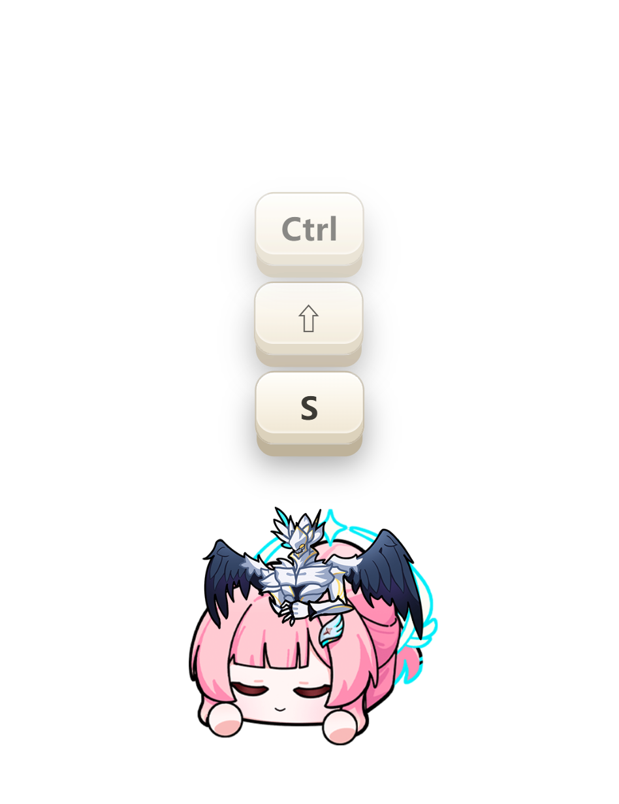
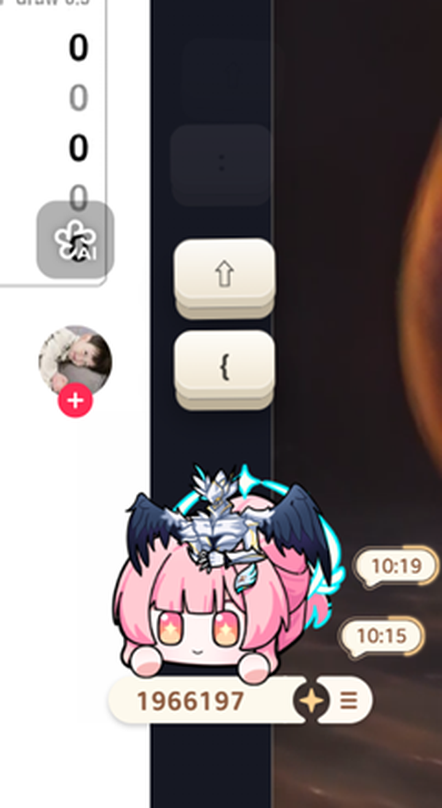
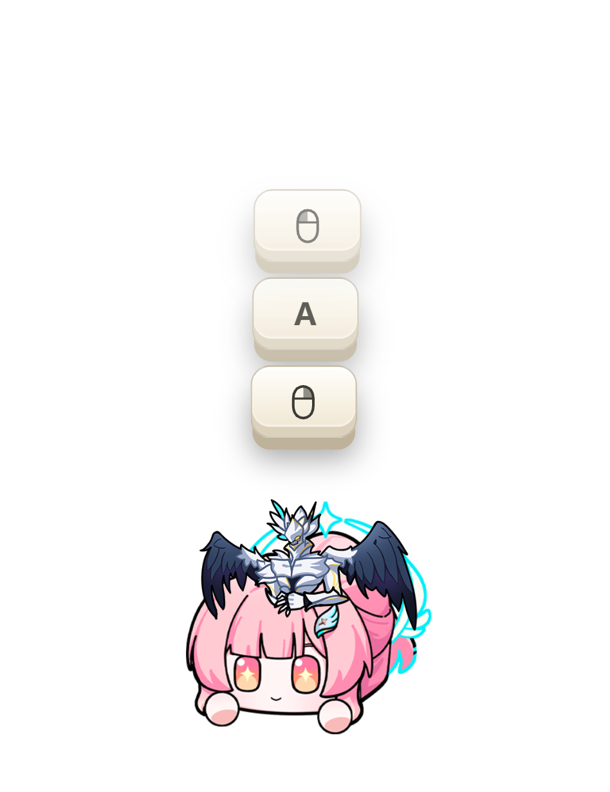
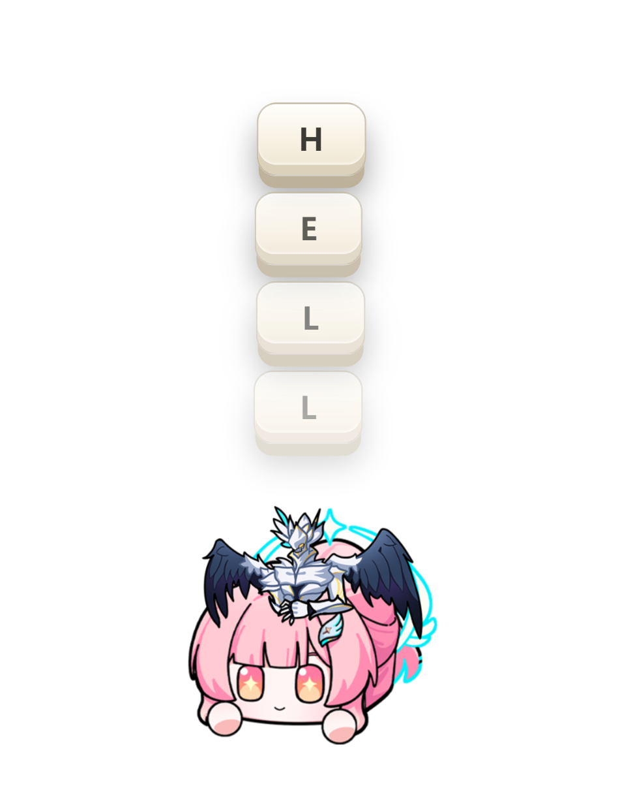
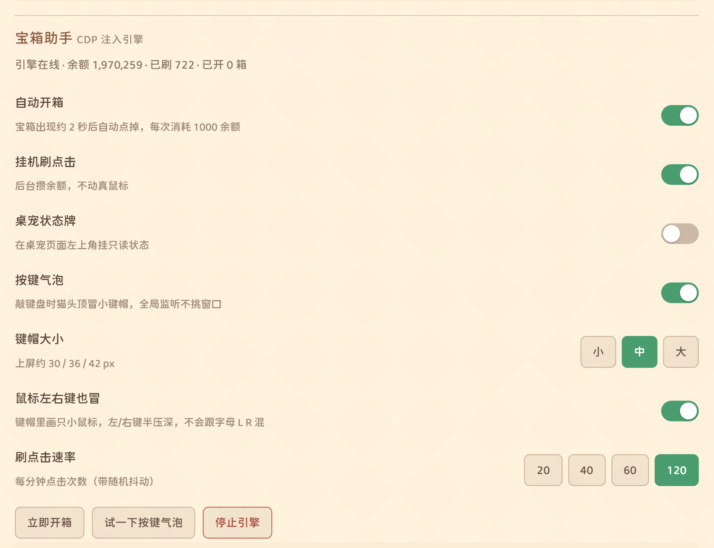

# better-wuwatappo

给 **WuwaTappo**（鸣潮桌宠）做的一点增强：自动开箱、挂机刷点击，还有敲键盘时从桌宠头顶冒出来的**键帽气泡**。

全部通过 CDP（Chrome DevTools Protocol）注入 Tappo 自己的 WebView2 页面实现——不修改 Tappo 的任何文件，不往游戏里注入任何东西，也不 hook 键盘。

> **English**: A small CDP-based enhancement for the *Wuthering Waves* desktop pet **WuwaTappo**. It auto-opens chests, farms idle clicks, and shows keycap bubbles above the pet whenever you type. Everything is injected into Tappo's own WebView2 page over the DevTools protocol — no game files touched, no keyboard hooks. Windows only, needs Python 3.8+ and `websockets`.



---

## 它长什么样

敲键盘的时候，猫头顶往上飘一叠奶白色的键帽，1 秒左右淡掉：

- **组合键不合并** —— `Ctrl+Shift+S` 是三个独立键帽，叠成一小堆，最新的贴最下。
- **双符号键认上档** —— 按住 Shift 敲 `1` 显示 `!`，敲 `[` 显示 `{`。
- **特殊键有图标** —— 空格、回车、退格、鼠标左右键都画成小图标，不用文字凑。
- **按住不放只冒一次** —— 忽略系统自动重复。
- **游戏里也冒** —— 采集走全局轮询，不依赖焦点。

| 组合键 | 上档符号 |
|---|---|
|  |  |
| **鼠标左右键** | **连续打字** |
|  |  |

> 上面几张都是透明背景的页面原图，直接抠出来的，没有桌面截图。

功能面板里可以直接关、调大小、开关鼠标键：



---

## 装法

### 0. 前提

- Windows 10/11
- WuwaTappo 装好并至少跑过一次
- **Python 3.8+**（安装时勾选 *Add Python to PATH*）
- 一个依赖：

```bash
pip install websockets
```

### 1. 打开 WebView2 的调试端口

注入要靠这个端口。用**管理员** PowerShell 跑一次（改注册表，永久生效）：

```powershell
$k = 'HKLM:\SOFTWARE\Policies\Microsoft\Edge\WebView2'
New-Item -Path $k -Force | Out-Null
Set-ItemProperty -Path $k -Name 'AdditionalBrowserArguments' -Value '--remote-debugging-port=9222'
```

改完**完全退出 WuwaTappo 再重开**（托盘图标也要退掉）。

验证：浏览器打开 <http://127.0.0.1:9222/json/list>，能看到一列页面就对了。

> ⚠️ 这一步会让本机任何程序都能连上桌宠页面（仅限 127.0.0.1）。不想要了就把这个注册表项删掉。

### 2. 放好文件

把整个文件夹放到任意位置（路径里带中文也没关系，脚本都按自身位置找文件）。

### 3. 启动

双击 **`启动引擎.vbs`**。它没有窗口，静悄悄在后台起一个监督员，之后每次 WuwaTappo 一启动就会自动带起引擎。

想开机自启，把 `启动引擎.vbs` 的快捷方式丢进 `shell:startup`（Win+R 输入那个就能打开启动文件夹）。

### 4. 停掉

双击 **`停止引擎.bat`**。它先写一个 `engine.stopped` 标记再杀进程，所以监督员不会立刻又给你拉起来。

想重新开，双击 `启动引擎.vbs` 就行（它会自动清掉那个标记）。

---

## 用起来

启动之后什么都不用做。想调设置就去 Tappo 的功能面板 → **设置** 页，最下面会多出一块「宝箱助手」：

| 项 | 说明 |
|---|---|
| 自动开箱 | 宝箱倒计时结束时自动点开 |
| 挂机刷点击 | 自动点桌宠刷点击数（有余额门槛，余额 < 1000 时不刷） |
| 桌宠状态牌 | 在桌宠页面左上角挂一个只读状态牌（余额/槽位/在线），**默认关**，嫌挡视野 |
| 按键气泡 | 键盘气泡总开关 |
| 键帽大小 | 小 / 中 / 大 |
| 鼠标左右键也冒 | 关掉就只认键盘 |
| 刷点击速率 | 20 / 40 / 60 / 120 次每分钟 |
| 试一下按键气泡 | 不敲键盘，直接演示一遍 |

设置存在 `%LOCALAPPDATA%\鸣潮宝箱助手CDP\config.json`，改完立即生效、重启不丢。

### 命令行

偶尔想手动看一眼状态：

```bash
python tappo_cdp.py --status          # 打印一次余额/槽位就退出
python tappo_cdp.py --run             # 前台跑（有控制台，方便看日志）
python tappo_cdp.py --run --hud       # 额外挂状态牌
python tappo_cdp.py --run --no-farm   # 只自动开箱，不刷点击
python tappo_cdp.py --run --rate 20   # 速率
python tappo_cdp.py --run --no-keybubble --no-kbmouse
python tappo_cdp.py --run --kbsize l
```

---

## 它是怎么工作的

```
WuwaTappo (Tauri + WebView2)
        ▲
        │  CDP over ws://127.0.0.1:9222
        │
   tappo_cdp.py  ← 引擎：轮询余额/槽位、点宝箱、注入键帽气泡
        ▲
        │  端口对账，挂了就拉起来
        │
   tappo_watch.py ← 监督员：看着 WuwaTappo.exe 与引擎
        ▲
        │  GetAsyncKeyState 全局轮询（8ms 一次，约单核 1.4%）
        │
     键盘 / 鼠标
```

几个绕不开的坑，踩过才知道：

**窗口被裁成只剩猫那一块。** Tappo 用 `SetWindowRgn` 把主窗口裁成猫附近一个小方块，键帽飞到猫头顶就在窗口区域外——系统直接不画，页面里 DOM 明明存在但屏幕上什么都没有。`RegionKeeper` 线程每 0.2 秒检查一次，有区域就清掉。窗口是 `WS_EX_TRANSPARENT`，铺满全屏也不挡任何点击（实测过命中测试）。

**页面渲染 ≠ 屏幕。** 用 `Page.captureScreenshot` 验证会得到"成功了"的假象，因为它截的是页面渲染，不受窗口区域约束。真要验证必须抓桌面。

**`.pet-dock` 带 `transform: scale(0.8)`。** 页面里写 45px，上屏只有 36px。注入 UI 要按这个换算。

**页面会被 Vue 重渲染。** 容器随时可能被删掉，所以每轮都做一次存活探测，没了就重建。同理 `window.__wutKeys` 也可能被冲掉。

**采集不能 hook 键盘。** 游戏带 ACE 反作弊，所以用 `GetAsyncKeyState` 轮询而不是 `SetWindowsHookEx`——轮询拿不到按键内容，也不需要注入任何进程。代价是每 8ms 扫一遍 92 个虚拟键，实测占单核 1.4%。

**Shift 上档是硬编码的。** 用的是 `ToUnicodeEx` 反查当前 US 布局得到的那张表。换成俄文/希腊/Dvorak 布局就不认了。

---

## 已知限制

- **只测过这一个版本的 Tappo。** Tauri/WebView2 页面结构变了（`.cat-mainbox`、`.reward-anchor--left|right` 这些选择器），注入就会失效。
- **要开 WebView2 调试端口**，等于本机多一个监听端口。只在 127.0.0.1，但确实是攻击面。
- **DPI 强相关。** 系统缩放不是 150% 的话，窗口区域的坐标换算要跟着改。
- **轮询不读输入法**。敲中文时气泡显示的是物理字母（`W` 而不是 `我`）——这个当初就是这么定的。
- 不保证长期跟进官方更新，就是个自用工具。

---

## 文件

```
tappo_cdp.py    引擎：CDP 客户端、开箱/刷点击、键帽气泡注入、面板注入
tappo_watch.py  监督员：看着桌宠与引擎，挂了就拉起来
启动引擎.vbs     双击启动（无窗口）
停止引擎.bat     双击停止（先写标记再杀进程）
效果图/          截图
备份/            开发过程的历史快照，不影响运行（未随仓库分发）
```

日志在 `%LOCALAPPDATA%\鸣潮宝箱助手CDP\logs\`，出问题先看 `cdp-YYYYMMDD.log`。

---

## 免责

自用工具，跟库洛游戏没有任何关系。脚本点的是 Tappo 自己的点击接口，不读游戏内存、不改游戏文件、不注入游戏进程。但**用它挂机是你的选择，封号风险自负**。

---

## 许可

[GPL-3.0](LICENSE) © BQOvO

拿去改、拿去传都行，改完的也得开源，并且说清楚改了哪儿。想让别人用上你的版本，得把源码一起给出去。
